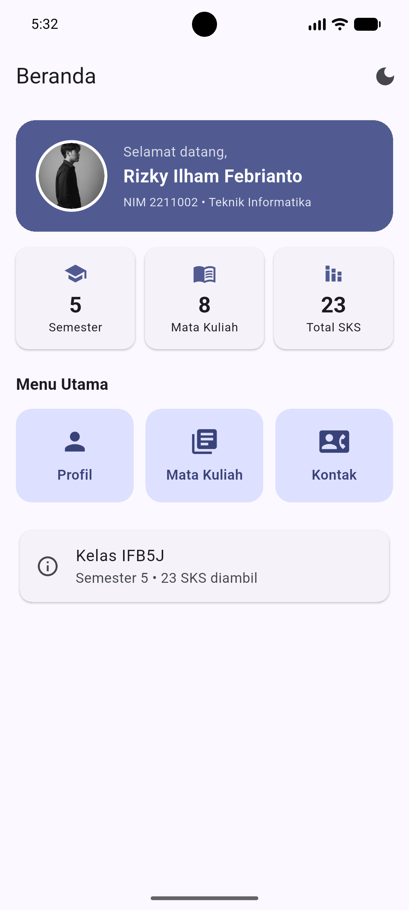
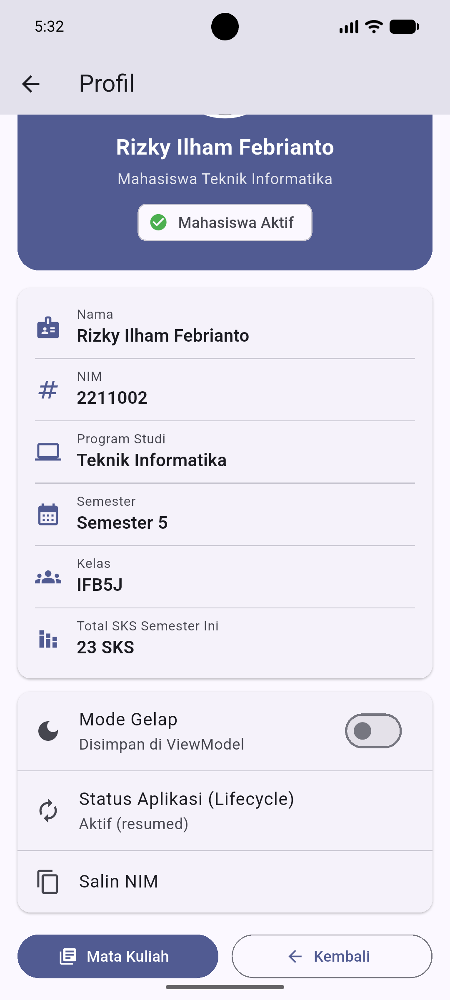
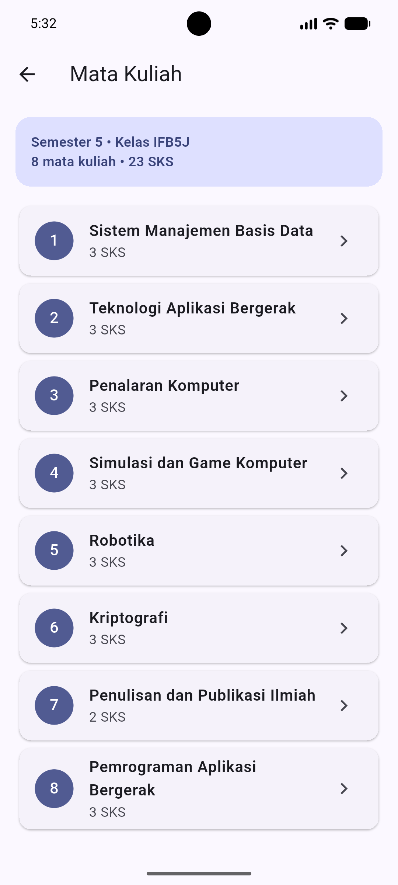
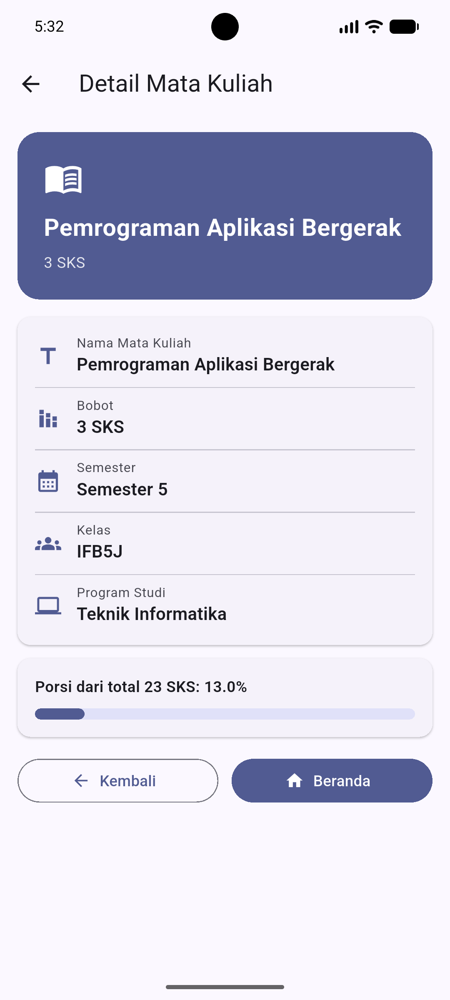
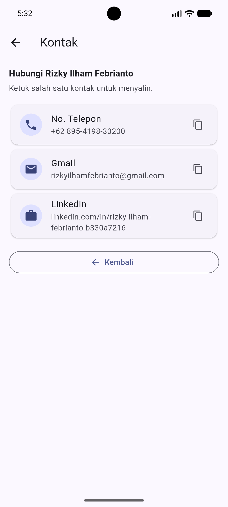
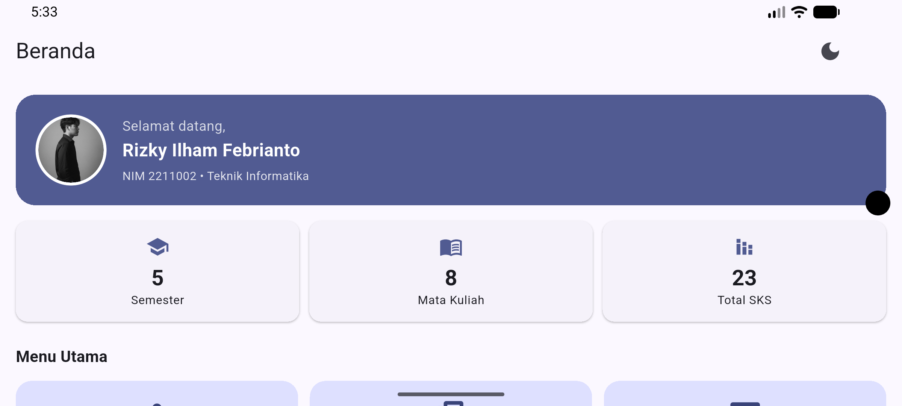

# Aplikasi Profil Mahasiswa

Aplikasi dashboard profil mahasiswa berbasis **Flutter** yang menerapkan **Navigation**, **Lifecycle**, dan **ViewModel** (Provider).
Tugas Pemrograman Aplikasi Bergerak - Materi 5.

# Identitas

| | |
|---|---|
| Nama | Rizky Ilham Febrianto |
| NIM | 2211002 |
| Program Studi | Teknik Informatika |
| Semester / Kelas | 5 / IFB5J |

# Fitur

- **Beranda**: sapaan, ringkasan semester, jumlah mata kuliah, dan total SKS, serta menu utama
- **Profil**: foto, nama, NIM, prodi, semester, kelas, status aktif, mode gelap, status lifecycle, salin NIM
- **Mata Kuliah**: 8 mata kuliah dengan total 23 SKS
- **Detail Mata Kuliah**: detail dan porsi SKS terhadap total
- **Kontak**: no. telepon, Gmail, dan LinkedIn (ketuk untuk menyalin)

# Tangkapan Layar

| Beranda | Profil | Mata Kuliah |
|:---:|:---:|:---:|
|  |  |  |

| Detail Mata Kuliah | Kontak |
|:---:|:---:|
|  |  |

**Tampilan landscape (rotasi layar):**



# Arsitektur

```
lib/
├─ main.dart                  # MultiProvider, MaterialApp, observer lifecycle
├─ app/routes.dart            # daftar route
├─ data/mahasiswa_data.dart   # model dan data
├─ viewmodels/                # ProfileViewModel, CourseViewModel
├─ screens/                   # 5 layar
└─ widgets/                   # komponen bersama
```

| Route | Layar |
|---|---|
| `/` | Beranda |
| `/profil` | Profil |
| `/matkul` | Daftar Mata Kuliah |
| `/matkul/detail` | Detail Mata Kuliah |
| `/kontak` | Kontak |

# Cara Menjalankan

```bash
flutter pub get
flutter run
```